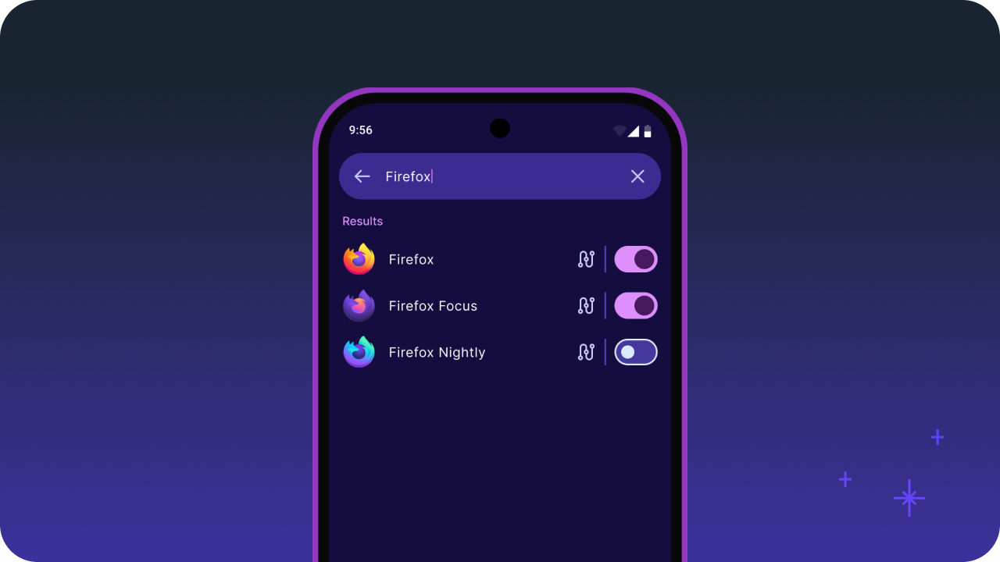
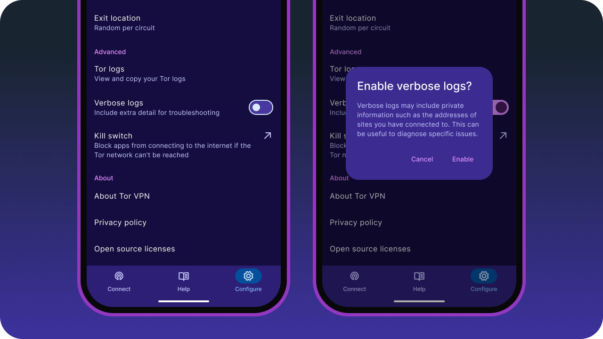
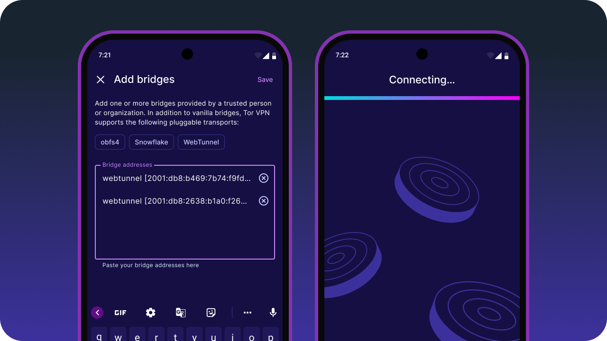
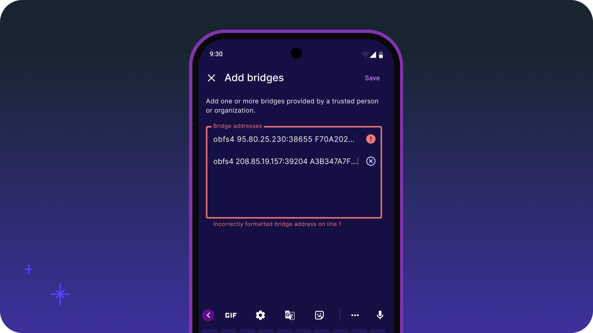
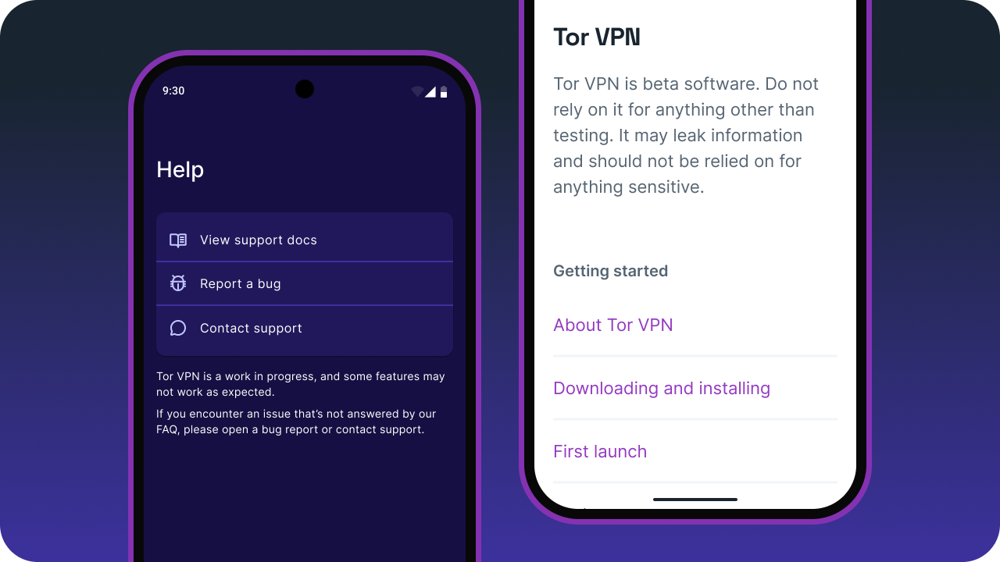
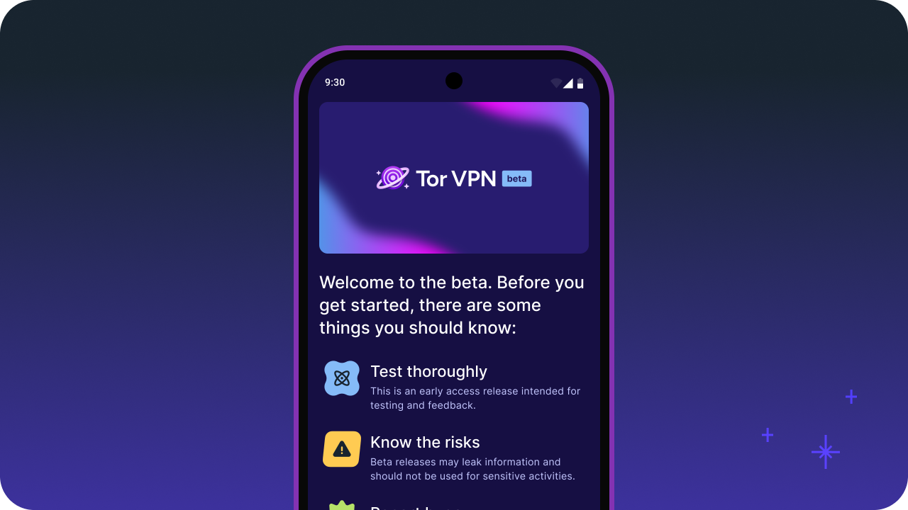

# Changelog

---

<!-- Key: New; Fixed; Improved; Deprecated; Removed; Security; Other -->

## Beta 9.1 (1.9.1Beta)

Beta 9.1 (1.9.1Beta) fixes several crashes and bugs reported since Beta 9, including crashes affecting Android 8, 9, and 10.

### Fixed

* Fixed a crash that could occur on Android 8, 9, and 10, caused by an incompatibility between Tor VPN's database driver and the SQL statements used on those versions of Android.
* Tor VPN no longer crashes when launched without an internet connection (for example, when Airplane mode is enabled).
* The Connect and Bridges screens now display the correct hint when multiple different bridge types (i.e. Pluggable Transports) have been configured.
* The system status bar is now styled correctly on older versions of Android.
* Offline support docs (which can be found in `Help > View support docs`) have been updated, including a fix for a broken link.

### Improved

* Migrated the About Tor VPN screen to [Jetpack Compose](https://developer.android.com/compose), Android's modern UI framework, and fixed a bug with the top app bar in the process.
* A confirmation snackbar now appears after saving bridges in the Add bridges dialog, which also provides a shortcut to connect.

### Removed

* Support for the 32-bit x86 architecture has been temporarily removed while we investigate crashes in onionmasq. This primarily affects users who run Tor VPN on an older emulator image. We plan to restore support in a future release.

---

## Beta 9 (1.9.0Beta)

{width=512px}

Beta 9 (1.9.0Beta) migrates the Apps screen to Jetpack Compose, which now includes the option to search your apps. This release also detects and displays a warning when a Private DNS provider hostname has been configured, which is not compatible with Tor.

### New

* The list of apps installed on your device is now searchable, making it significantly easier to find a specific app.
* Tor VPN does not support setting a Private DNS provider hostname manually, as this bypasses Tor and reveals the sites you visit to your DNS provider. Now, Tor VPN will warn you and disconnect the VPN when a private DNS provider hostname has been configured.

### Fixed

* Restored some instructions that went missing from the top of the Add bridges dialog in Beta 5.
* Addressed many small inconsistencies with Tor VPN's user interface while refactoring the Apps screen (more on that below).

### Improved

* Migrated the Apps screen (and its sub-screens) to [Jetpack Compose](https://developer.android.com/compose), Android's modern UI framework. This is phase one of a longer-term project to convert Tor VPN to Jetpack Compose and reduce our reliance on Android's legacy UI framework, [Views](https://developer.android.com/studio/views/layout-editor).

---

## Beta 8 (1.8.0Beta)

{width=512px}

Beta 8 (1.8.0Beta) adds support for additional bridge flags, plus the ability to toggle between normal and verbose Tor logs. This release also features an update to Arti and several small refinements to the user interface.

### New

* Additional bridge flags, including for Server Name Indication (SNI) spoofing, are now supported by Tor VPN.
* Verbose Tor logs can now be manually enabled in Configure to capture extra detail to help with troubleshooting.

### Fixed

* Added a (previously missing) translucent background to the 3-button navigation bar to improve readability when overlaying other content.

### Improved

* The icon used for the exit location button has been swapped to a more recognizable globe.
* Swapped the snackbar added in Beta 6 for the Apps retrieval error to a more permanent card.
* Bridges provided by you are now selected automatically for use when added.
* Updated and improved translations, especially German.

### Other

* Updated Arti, our modern Tor client written in Rust, to Arti 2.3.0 (7 May 2026).

### Community Contributions

Thank you to the following volunteers who contributed their expertise, labor and time to this release:

* @ahujadivyam 

---

## Beta 7 (1.7.0Beta)

{width=512px}

Beta 7 (1.7.0Beta) introduces fixes for several bugs affecting Tor VPN's user interface. This release also features an update to onionmasq and other minor improvements.

### New

* Tor VPN now supports the Slovak language.

### Fixed

* Apps that have been excluded from the VPN no longer switch to protected after receiving an app update.
* Large buttons on the Connect view are no longer cropped or awkwardly positioned for right-to-left (RTL) languages.
* Navigating backwards now behaves as expected when browsing the support docs.

### Improved

* Tor VPN does a better job of verifying that bootsrapping has reached 100% before displaying a "Connected" status.
* When adding bridges, duplicate bridge lines are now removed automatically.

### Other

* Tor VPN now targets Android API 36.
* Updated Tor VPN to the most recent version of onionmasq.
* Updated other dependencies like Glide, Gson, and WebKit.

---

## Beta 6 (1.6.0Beta)

{width=512px}

Beta 6 (1.6.0Beta) continues to improve Tor VPN's overall stability, with a focus on improving quality of life for bridge users. This release also features an update to onionmasq and other minor improvements.

### New

* Vanilla bridges (i.e. bridges that don’t use a Pluggable Transport) are now supported by onionmasq and Tor VPN.

### Fixed

* Offline support docs (which can be found in `Help > View support docs`) are now synced with the content published on [support.torproject.org/tor-vpn](https://support.torproject.org/tor-vpn/) at the time of release.
* After selecting a new exit location and swiping back to return to the Connect view, the icon button will update to feature the correct country flag.
* The locations of exit relays should match the selected exit country more consistently.
* “WebTunnel” rightfully has a capital T.

### Improved

* Tor logs have been streamlined, with a similar logging level to Tor Browser. In future, we’ll add the option to toggle between normal and verbose logging levels.
* Tor will respect the order of bridges added by users (from top to bottom) when attempting to establish a connection.
* Tor VPN now displays error messages when the bridge bot fails to fetch bridges, or the list of apps installed on your device cannot be retrieved.
* A bug that caused Tor VPN to crash when starting the VPN service should now display an error, without crashing the app. If successful, a more comprehensive fix will follow in a future release.

### Other

* Updated Tor VPN to the most recent version of onionmasq.

---

## Beta 5 (1.5.0Beta)

{width=512px}

Beta 5 (1.5.0Beta) improves Tor VPN's stability by fixing several troublesome crashes and bugs. This release also features an update to onionmasq and other minor improvements.

### New
* Tor VPN is now available for download on [F-Droid](https://f-droid.org/en/packages/).

### Fixed
* Fixed a crash that could occur on Android 10 and 11 when checking network connection ownership.
* Fixed a crash that could occur when launching or resuming the app on Android 7, 14, 15, and 16.
* Fixed a crash that could occur when starting the VPN service on Android 14, 15, and 16.
* Protected apps in the Apps view no longer appear to be deselected when Tor VPN is force stopped.
* Tor VPN no longer crashes when attempting to request bridges by email if no email client is installed.
* The buttons to connect and disconnect the VPN now appear as expected on Android 7.
* The system navigation bar is now styled correctly on older versions of Android.

### Improved
* Several small strings of text have been revised to improve how bridges are labeled and described throughout the app.
* Tor-powered apps (like Tor Browser) on your device are now exempt when "Block connections without VPN" is enabled for Tor VPN.

### Other
* To support the F-Droid release and reduce APK sizes, Tor VPN now builds separate `.apk` files for each architecture.
* Onionmasq's minimum supported Rust version (MSRV) is now 1.87.
* Updated Tor VPN to the most recent version of onionmasq.

---

## Beta 4 (1.4.0Beta)

{width=512px}

Beta 4 (1.4.0Beta) adds support for WebTunnel bridges to Tor VPN. This release also features an update to onionmasq, fixes several bugs and crashes, and includes other minor improvements.

### New
* WebTunnel bridges are now supported by Tor VPN and can be added in the Bridges view. To get WebTunnel bridges, message [@GetBridgesBot](https://t.me/GetBridgesBot) on Telegram or visit [bridges.torproject.org](https://bridges.torproject.org/).

### Fixed
* The Telegram link on the Contact support sheet now points to the correct handle: [@TorProjectSupportBot ](https://t.me/TorProjectSupportBot).
* Text no longer gets clipped on the Configure view after increading the system font or display size in Settings.
* Rapidly toggling switches in the Apps view or restarting the app no longer causes Tor VPN to become unresponsive.
* The height of the Bridge addresses text box in the Add bridges view is now correct on older versions of Android.
* Top app bars now use the correct color scheme for Tor VPN when your device's theme is set to dark.

### Improved
* The list of apps in the Apps view is now case insensitive. This means apps beginning with a lowercase "e" now appear alongside apps that begin with an uppercase "E", for example.
* Screen readers now announce your exit location (if a single exit location has been configured) when reading the exit location button.
* More cutout areas (e.g. for cameras) are now handled correctly without compromising Tor VPN's edge-to-edge design.

### Other
* Updated onionmasq's build environment to Debian Trixie, Gradle 9.1 and Java 21.
* Updated Tor VPN to the most recent version of onionmasq.

---

## Beta 3 (1.3.0Beta)

{width=512px}

Beta 3 (1.3.0Beta) adds basic error validation for user-added bridge lines to Tor VPN. This release also features an update to onionmasq, fixes several bugs and crashes, and includes other minor improvements.

### New
* Tor VPN now highlights invalid bridge lines with an error message, rather than silently accepting them.

### Fixed
* Text now renders in Inter (as intended) rather than Roboto (by default).
* The background of the system status bar now matches the top app bar on older versions of Android.
* Tapping on the circuit icon in Configure > Apps now opens the App view, instead of doing nothing.

### Improved
* Implemented additional animations between views to provide smoother transitions between screens.
* Adjusted the size and positioning of the monochrome launcher icon to match the full-color version.
* Added support for the swipe gesture to navigate backwards in Tor VPN's support docs.
* Back buttons in top app bars now include accessible labels.

### Other
* Updated Tor VPN to the most recent version of onionmasq.

---

## Beta 2.1 (1.2.1Beta)

Beta 2.1 is a limited release to test a potential fix for a crash occurring on certain devices (primarily Android 14/SDK 34+).

### Fixed
* Traffic up/down displayed on the persistent notification now matches the data card in the app itself.
* The system navigation bar now matches the background on older versions of Android.

### Improved
* Tor VPN now makes clear what [pluggable transports](https://support.torproject.org/glossary/#pluggable-transports) (PTs) are currently supported when adding bridges.
* Updated the icon that appears in notifications and the system status bar to match the launcher icon.

### Other
* Updated `androidx.core:core-ktx` to address a crash that could occur while starting the VPN service on newer versions of Android.
* Upgraded Tor VPN to Java 21, Gradle 9 and compileSDK 36.

---

## Beta 2 (1.2.0Beta)

{width=512px}

Beta 2 (1.2.0Beta) includes a small number of fixes for crashes, minor bugs and other improvements.

### New
* Support docs can now be accessed offline without needing to load an external web page.

### Fixed
* Tor VPN no longer stops protecting an app after the app has been updated.
* The icon-button to refresh circuits now appears once, instead of twice, on larger screen sizes.
* Fixed several instances of broken layouts on older Android devices and landscape screen orientations.
* Fixed a crash that could occur when connecting the VPN.
* Fixed a crash that could occur when Tor VPN is retrieving the list of installed applications.

### Improved
* Top app bars now follow Google's [Material Design 3 guidelines](https://m3.material.io) more accurately, using a solid background and shrinking down to a smaller size when scrolling.
* Replaced the ripple overlay with a pill transition effect on the app navigation bar that aligns with M3's design guidelines.
* Improved display compatibility for phones with notches and curved screens.
* Improved build reproducibility using containerization.

### Other
* Updated Tor VPN's translations.

---

## Beta 1 (1.0.0Beta)

{width=512px}

Welcome to the closed beta for Tor VPN.

This is an early access release intended for testing and feedback. If you encounter a bug, please report it back to the team by opening a new issue in the [VPN project on GitLab](https://gitlab.torproject.org/tpo/applications/vpn/-/issues).

Changes since pre-alpha 0.9.0 include:

### New

* Replaced the onboarding dialog with a new version designed for beta testers.
* Updated the launcher icon with Tor VPN's new application icon.
* Starting with Beta 1, Tor VPN now supports [reproducible builds](https://reproducible-builds.org).
* Added licensing information and our privacy policy to the About view, both of which can be accessed offline.
* Added an option to donate to the Tor Project from the About view.
* Tor VPN now links directly to our support docs from within the Help view.
* Newly installed apps are now protected by default when "Protect all apps" is enabled, and uninstalled apps are removed from the VPN automatically.

### Fixed

* Fixed an issue whereby “Use bridges” could be switched on without a bridge having been configured by defaulting to built-in obfs4.
* The persistent notification no longer flickers or becomes unresponsive when Tor VPN is connected.
* Multiple potential crashes that were reported in prior pre-alpha releases.
* Tor VPN no longer becomes unresponsive when stopping or restarting the VPN.
* Fixed a crash that could occur when viewing Tor logs.
* Fixed another crash that could occur when stopping the VPN in certain situations.

### Improved

* Tor VPN’s list of built-in obfs4 bridges is now synced with Tor Browser's with each release.
* Implemented interaction states for various components that align with Google's [Material Design 3 guidelines](https://m3.material.io).
* Implemented additional animations between views to provide smoother transitions between screens.
* Implemented various accessibility improvements.

### Removed

* Removed the setting to disable confirmation when requesting a new circuit.

### Other

* Updated Tor VPN's translations.

---

## Pre-alpha releases

Show pre-alpha release notes

## Pre-alpha 0.9.0
* update color scheme
* fix: show connection stats in tablet landscape layout
* fix: App crash when configuring apps
* update bridge bot UX to latest figma designs
* update manual bridge selection UI to latest figma designs
* update tor Logs UI to latest figma designs
* update app routing UI to latest figma designs
* fix: flickering in app routing screen
* fix: long app name entries overlap circuit icon
* add ability and instructions to use a local build of AndroidOnionmasq
* fix: App detail view: App on/off doesn't change the status
* Update TargetSDK to API 35
* fix disconnecting VPN in system settings, auto-reconnect from Tor VPN
* accessibility improvements

## Pre-alpha 0.8.0
* improved accessibility in various screens
* improve location selection UX
* fix network traffic leak on VPN permission revocation
* fix tor traffic obfuscation
* fix excluding tor-powered apps such as Tor Browser from being routed via the VPN
* landscape layout fixes
* indicate in UI if internet connectivity is missing
* dependency updates
* onionmasq: improved bootstrapping state handling
* onionmasq: fixed file descriptor leaks
* onionmasq: improved udp packet validation
* onionmasq: fixed IPv6 DNS handling
* onionmasq: fixed IPv6 packet handling
* onionmasq: fixed memory leaks

## Pre-alpha 0.7.0
* phosphor icon set
* switch to material3 design
* updated color scheme
* fix refresh circuits dialog UI

## Pre-alpha 0.6.2
* fix various strings used in the application (connections, units used for KB/MB/GB, etc.)
* center exit node selection title
* correctly display downstream data usage display
* center the exit node selection title
* new start/stop button and bridgeline setting color scheme
* inverse the download and upload stats UI
* better data and time formatting
* reverse the order of logs
* don't list the tor-vpn app in routing list
* various layout fixes
* bump onionmasq to 0.6.2

## Pre-alpha 0.6.1
* transform manual bridge entry dialog to a full-scale fragment
* changed app routing selection UI behavior
* added About Screen
* new localizations including script for easier updates
* updated onionmasq dependencies
* fix bootstrap status (onionmasq)
* fixed progress animation
* fix possible app crash related to animation handling

## Pre-alpha 0.6.0
* General settings screen, including launcher icon and name selection
* Bridge Bot UI
* new Help menu
* cleaner UI:
    updated bottom navigation layout
    remove timer in main screen shown when the VPN is running
    revamp app detail screen
* updated built-in bridges
* fix on-off-button state transition
* fix crash that occurs if the user removes the VPN permissions while the VPN is still running

## Pre-alpha 0.5.0
* Quick Settings Tile to start/stop the VPN
* Help Pages support (hidden in this version)
* improved tor exit country selection
* fix Leak Canary crash (only available in debug builds)
* fix refreshing tor circuits on configuration changes
* fix crashes related to tapping different buttons at the same time

## Pre-alpha 0.4.0
* support for Android API 34
* Request bridges in app
* request bridges from alternative locations
* fix missing UI state for the case only some apps were selected for onion routing
* fix app crash

## Pre-alpha 0.3.0
* Add PT (obfs4)
* Update UI
* Adding several tests
* Manual bridge selection
* Add bridge settings
* Add readme
* String changes
* And more

## Pre-alpha 0.2.0
* Updated UI
* App detail screen including throughput and circuit information
* Global exit node selection
* trigger new identities (circuits) per app or globally
* minimum SDK increased to Android 7

